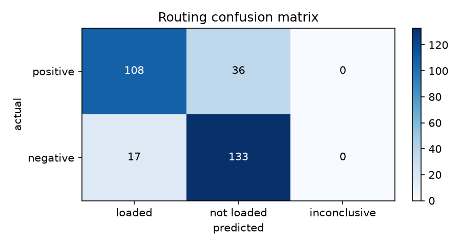
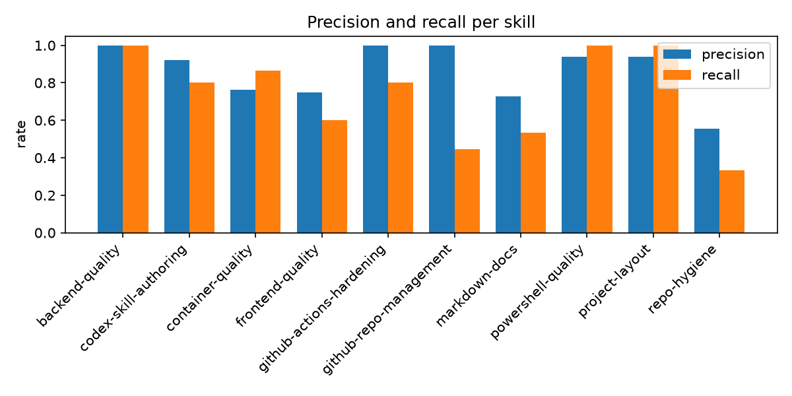
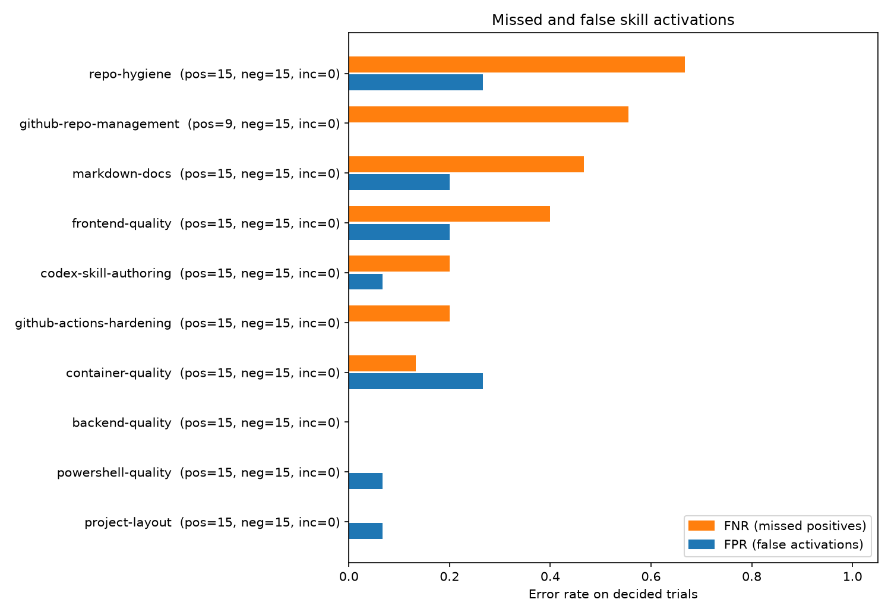
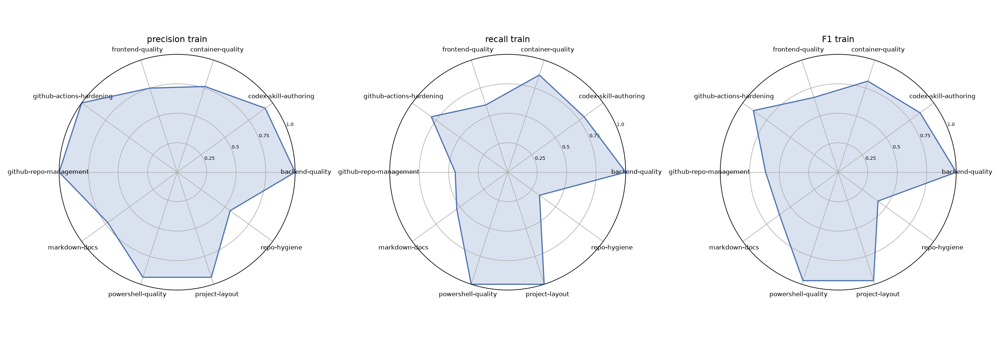
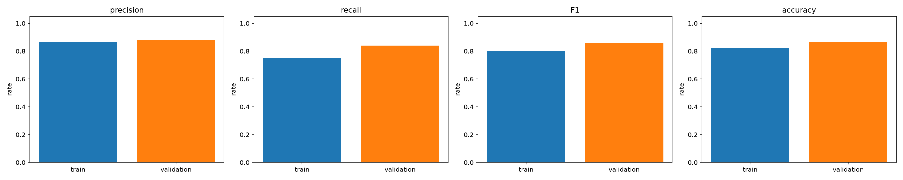

# repo-maintenance-skills

[English](README.md) | [中文](README_zh.md)

[](CHANGELOG.md)
[](https://github.com/autentisitet/repo-maintenance-skills/actions/workflows/ci.yml)
[](https://developers.openai.com/codex/skills/)
[](https://platform.claude.com/docs/en/agents-and-tools/agent-skills/overview)
[](https://platform.claude.com/docs/en/agents-and-tools/agent-skills/best-practices#evaluation-and-iteration)

Codex skills for everyday repository maintenance, covering documentation, GitHub Actions,
repository configuration, project layout, frontend and backend quality, PowerShell scripts, and
Docker/Podman deployment. We recommend choosing the skills that fit your project and adapting
their checks and workflows to its needs.

These skills grew out of real maintenance workflows. We do not recommend copying directory,
deployment, or tooling choices with specific prerequisites without checking whether they fit
your project. This is an unofficial project, not affiliated with or endorsed by OpenAI. It
primarily targets Codex and does not promise compatibility with other agents.

## Skills

| Skill | Purpose |
| --- | --- |
| [codex-skill-authoring](skills/codex-skill-authoring/SKILL.md) | Create, review, and simplify Codex skills |
| [markdown-docs](skills/markdown-docs/SKILL.md) | README, CHANGELOG, CONTRIBUTING, and issue templates |
| [github-actions-hardening](skills/github-actions-hardening/SKILL.md) | Workflows, Dependabot, CodeQL, and CI logs |
| [github-repo-management](skills/github-repo-management/SKILL.md) | Branches, batched commits, test suggestions, and GitHub repository management |
| [repo-hygiene](skills/repo-hygiene/SKILL.md) | Dotfiles, ignore rules, dependency exports, and lockfile sync |
| [project-layout](skills/project-layout/SKILL.md) | Frontend, backend, deployment config, tests, scripts, examples, docs, and training code |
| [container-quality](skills/container-quality/SKILL.md) | Shared Docker/Podman builds, Compose overrides, SELinux, and log rotation |
| [backend-quality](skills/backend-quality/SKILL.md) | Backend API contracts, FastAPI OpenAPI, migrations, tests, code standards, and the Nginx public entry point |
| [frontend-quality](skills/frontend-quality/SKILL.md) | HTML/CSS value convergence, render verification, and accessibility |
| [powershell-quality](skills/powershell-quality/SKILL.md) | PowerShell scripts: cmdlet/CIM selection, resource cleanup, pipeline, and error handling |

After installation, invoke a skill explicitly with names such as `$markdown-docs`, or let its
description auto-match a relevant task.

---

## Installation

Keep this repository as the versioned source and link `skills/*` into
`${CODEX_HOME:-~/.codex}/skills`.

### macOS, Linux, and WSL

```bash
git clone https://github.com/autentisitet/repo-maintenance-skills.git ~/repo-maintenance-skills
cd ~/repo-maintenance-skills
make install
```

By default, `skills/*` is symlinked into `${CODEX_HOME:-~/.codex}/skills`. For an independent copy:

```bash
make install-copy
```

### Windows PowerShell

```powershell
git clone https://github.com/autentisitet/repo-maintenance-skills.git "$HOME\repo-maintenance-skills"
Set-Location "$HOME\repo-maintenance-skills"
.\scripts\links\install.ps1
```

Directory junctions are created by default; use `.\scripts\links\install.ps1 -Copy` for an
independent copy.

To remove this repository's installed skills:

```bash
make uninstall
```

On native Windows use `.\scripts\links\uninstall.ps1` (add `-WhatIf` to preview removals).
The uninstallers remove only links pointing at this checkout or copies bearing its installation
marker. Other skills and unknown same-named directories are left untouched; the source repository
is never deleted.

`--force` / `-Force` only replaces links that point at this repository or copies marked by this
project's installation marker. When it encounters a same-named directory of unknown origin, it stops
rather than deleting a skill the user maintains themselves.

The `make` targets assume a POSIX shell and are intended for macOS, Linux, and WSL. On native
Windows, install with the PowerShell script above and run validation or evals inside WSL or Git Bash.

---

## Updating

Symlink and junction installs use this repository as their live source, so pulling updates is
enough:

```bash
git pull
make validate
```

Copy installs need to overwrite the corresponding copy:

```bash
./scripts/links/install.sh --copy --force
```

On Windows use `.\scripts\links\install.ps1 -Copy -Force`. Only links created by this project or
copies marked with the installation marker are replaced.

---

## Structure

```text
repo-maintenance-skills/
├── .github/
│   └── workflows/               # CI validation and Windows installer smoke tests
├── assets/
│   └── evals/                   # tracked README visualization assets
├── evals/
│   ├── train_queries.json
│   ├── validation_queries.json
│   ├── artifact_acceptance.md   # output-quality acceptance cases
│   ├── artifact-reviews/        # review template and vetted trial reports
│   └── results/                 # generated locally; ignored by Git
├── scripts/
│   ├── evals/                   # dataset validation, discovery, activation, summarize, plot
│   ├── links/                   # installation helpers
│   └── packages/                # skill package validation
├── skills/
│   └── <skill-name>/
│       ├── SKILL.md
│       ├── agents/openai.yaml
│       ├── references/
│       ├── scripts/
│       └── assets/
├── tests/
├── CHANGELOG.md                 # versioned release history
├── pyproject.toml               # uv project: dependencies only, no packaging
├── uv.lock
├── requirements.txt             # exported from uv.lock
└── Makefile
```

Directories other than `SKILL.md` are created as needed; empty directories and placeholder files
are not kept.

---

## Validation

Use Python 3.12+ and install dependencies with uv (or pip from the exported `requirements.txt`):

```bash
uv sync
make validate
# Optional: verify Codex skill discovery without a model call
make eval
```

If you prefer pip:

```bash
python3 -m venv .venv
.venv/bin/python -m pip install --require-hashes -r requirements.txt
make validate PYTHON=.venv/bin/python
```

`make validate` covers:

- [Skill packages](scripts/packages/validate_skills.py): YAML frontmatter, names, resource links,
  path boundaries, obvious sensitive output, and `agents/openai.yaml`; diagnostics identify the
  applicable specification layer.
- [Eval datasets](scripts/evals/validate_skill_evals.py), JSON/CSV sync, unit tests, Markdown
  structure, and shell syntax.

`make eval` also checks Codex skill discovery after the offline checks; it does not call a model.

The `make` targets and the `scripts/links/*.sh` scripts are POSIX-only. Native Windows users should
install or update with the PowerShell scripts and run the Python checks directly:

```powershell
python -m scripts.packages.validate_skills --strict
python -m scripts.evals.validate_skill_evals
python -m scripts.evals.convert_queries check evals/train_queries.json evals/train_queries.csv
python -m scripts.evals.convert_queries check evals/validation_queries.json evals/validation_queries.csv
python -m unittest discover -s tests -p "test_*.py"
```

CI runs the validation suite on Ubuntu and the PowerShell installer smoke tests on Windows.

---

## Evaluation

`evals/train_queries.json` and `evals/validation_queries.json` contain 160 routing cases across ten
skills: 100 training and 60 held-out validation cases. Every skill has eight positive and eight
negative cases. The queries cover direct, indirect, embedded, and boundary scenarios.

Use the Make targets as the stable project interface:

| Command | Purpose |
| --- | --- |
| `make eval` | Run offline validation and Codex skill discovery without a model call |
| `make smoke MODEL=<model>` | Run one positive and one negative query per skill |
| `make eval-train MODEL=<model>` | Run every training query three times |
| `make eval-validation MODEL=<model>` | Run every held-out validation query three times |
| `make eval-full MODEL=<model>` | Run both full splits |
| `make metrics` | Summarize the saved train and validation results |
| `make plot` | Render routing charts from saved results |
| `make retry-set` | Extract timed-out cases for an explicit retry |
| `make cross CROSS_MODELS="model-a model-b"` | Compare validation outcomes across models |
| `make csv-export` / `make csv-import` / `make csv-check` | Maintain the Excel-friendly query files |

Each routing trial starts an independent `codex exec` session with multi-agent disabled. Model
evaluations consume capacity, transmit queries, and use the CLI's existing login. Early stopping
may omit usage, so reported token totals are lower bounds. See the [evaluation guide](evals/README.md)
for authentication, isolation, and result semantics.

Artifact quality is assessed separately. Only one limited trial has been reviewed; there is no
repository-wide quality score:

- [Acceptance samples](evals/artifact_acceptance.md): a fixture, task, and pass/fail conditions per skill.
- [Temporary workspace workflow](evals/artifact_acceptance.md): copy the skill into a system temporary
  directory and run checks there, with no link back to this repository.
- [Review template](evals/artifact-reviews/TEMPLATE.md): publish only redacted, independently checked
  evidence; the [single trial report](evals/artifact-reviews/2026-11-13-repo-hygiene.md) remains separate.

For a cheaper routing smoke test, set `SAMPLE_PER_LABEL=N` and `RUNS=1`; see the
[evaluation guide](evals/README.md) for sampling and cost limits.

| Result | Status |
| --- | --- |
| Codex skill discovery | 10/10 discovered and enabled |

### Routing metrics (historical)

This archived `deepseek-flash` routing evaluation covers 294 train and 177 validation trials
from a historical subset. It measures whether a skill was read, not the quality of the resulting
work. The current skills and query set differ; a full model-backed evaluation was not rerun due
to cost. These figures are **not current-version scores**. See the [evaluation guide](evals/README.md)
for data provenance, freshness checks, and chart regeneration.

**Confusion counts** (positive means the target skill should be read):

| Count | Train | Validation | Combined |
| --- | ---: | ---: | ---: |
| Trials | 294 | 177 | 471 |
| TP | 108 | 73 | 181 |
| FN | 36 | 14 | 50 |
| FP | 17 | 10 | 27 |
| TN | 133 | 78 | 211 |
| Inconclusive | 0 | 2 | 2 |

**Routing rates** (inconclusive trials are excluded from these denominators):

| Metric | Train | Validation | Combined |
| --- | ---: | ---: | ---: |
| Precision | 0.8640 | 0.8795 | 0.8702 |
| Recall | 0.7500 | 0.8391 | 0.7835 |
| F1 | 0.8030 | 0.8588 | 0.8246 |
| Accuracy | 0.8197 | 0.8629 | 0.8358 |
| FPR | 0.1133 | 0.1136 | 0.1134 |
| FNR | 0.2500 | 0.1609 | 0.2165 |
| Specificity | 0.8867 | 0.8864 | 0.8866 |
| Inconclusive rate | 0.0000 | 0.0113 | 0.0042 |
| Mean time (s) | 28.89 | 28.59 | 28.78 |
| Median time (s) | 10.91 | 10.81 | 10.82 |

With $N$ total trials, the displayed rates are computed as follows:

$$
\begin{aligned}
P &= \frac{TP}{TP+FP} \\
R &= \frac{TP}{TP+FN} \\
F_1 &= \frac{2TP}{2TP+FP+FN} \\
\mathrm{Accuracy} &= \frac{TP+TN}{TP+FN+FP+TN} \\
\mathrm{FPR} &= \frac{FP}{FP+TN} \\
\mathrm{FNR} &= \frac{FN}{FN+TP} \\
\mathrm{Specificity} &= \frac{TN}{TN+FP} \\
\mathrm{InconclusiveRate} &= \frac{N_{\mathrm{inconclusive}}}{N}
\end{aligned}
$$

### Routing visualizations (historical)

The charts use the same historical subset as the table above.











---

## Design conventions

- **Personal workflow first.** Personal repeated needs, terminology, and preferences can directly
  become constraints; don't rewrite them for generality.
- **Only write information that changes decisions.** Don't repeat basic capabilities and generic
  tutorials that Codex already has.
- **Split on demand.** `SKILL.md` keeps shared constraints; conditional details go into
  `references/`; deterministic operations go into `scripts/`.
- **Keep wording consistent with constraint strength.** Safety and correctness requirements use
  "must/never"; minimum scope uses "at least"; experiential practices use "recommend/usually";
  conditional tasks use "if/when".
- **Control context cost.** A few skills with real gains are more valuable than many thin skills.
- **Keep trust and execution separate.** Project skills require workspace trust; referencing a script
  never bypasses the host sandbox or approval policy.
- **Contain resources and redact output.** Skill resources must stay inside their skill root. Scripts
  and eval artifacts must not expose tokens, environment variables, authorization headers, or user
  data.

---

## License

This project is licensed under the [MIT License](LICENSE).
Report vulnerabilities privately as described in [SECURITY.md](SECURITY.md).
