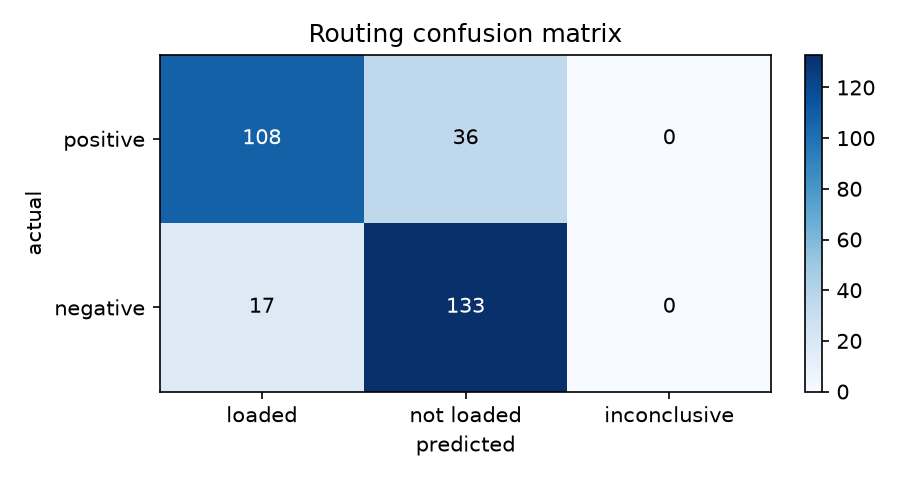
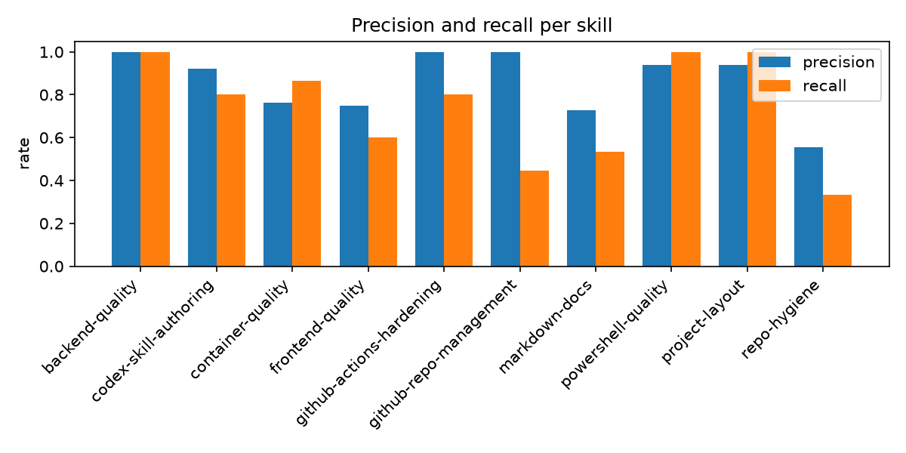
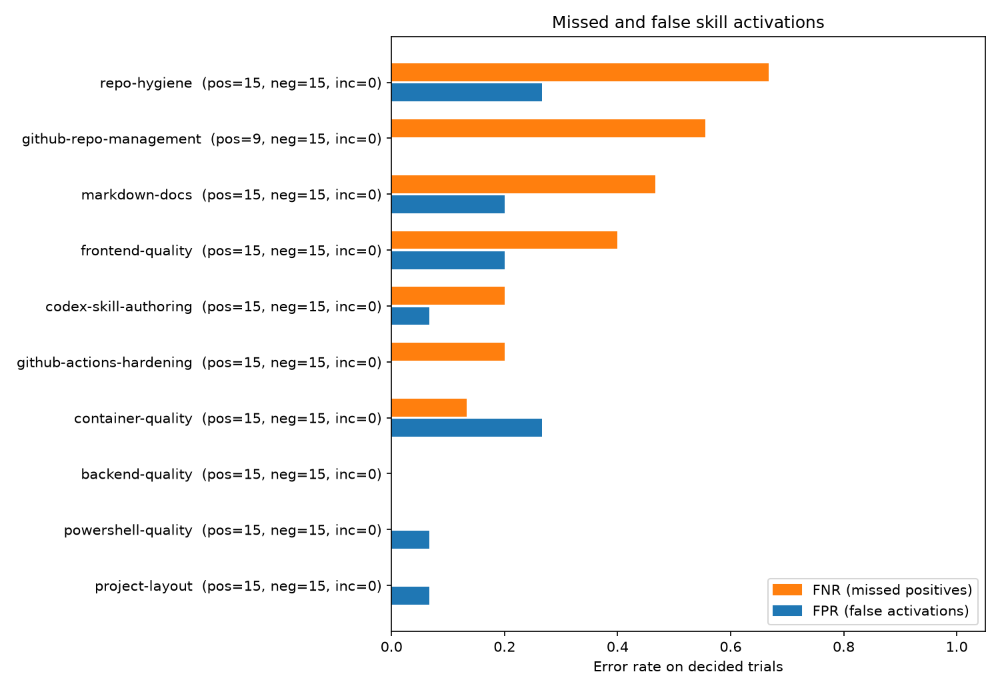
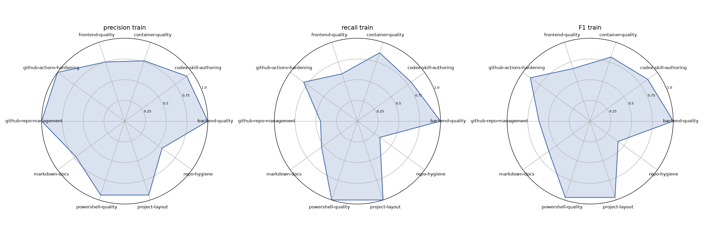
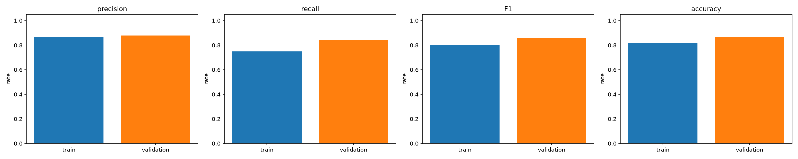

# repo-maintenance-skills

[English](README.md) | [中文](README_zh.md)

[](CHANGELOG.md)
[](https://github.com/autentisitet/repo-maintenance-skills/actions/workflows/ci.yml)
[](https://developers.openai.com/codex/skills/)
[](https://platform.claude.com/docs/en/agents-and-tools/agent-skills/overview)
[](https://platform.claude.com/docs/en/agents-and-tools/agent-skills/best-practices#evaluation-and-iteration)

面向仓库日常维护的 Codex skills，覆盖文档、GitHub Actions、仓库配置、项目目录、前后端质量、
PowerShell 脚本和 Docker/Podman 部署。推荐选用与自己项目匹配的 skill；建议结合项目需求，
调整其中的检查方法和操作流程。

这些 skill 来自实际维护工作流。不建议直接照搬其中有适用前提的目录、部署和工具选择；
请先确认它们符合项目现状。本项目是非官方项目，与 OpenAI 不存在隶属或背书关系；
目前主要面向 Codex，未承诺兼容其他 agent。

## Skills

| Skill | 用途 |
| --- | --- |
| [codex-skill-authoring](skills/codex-skill-authoring/SKILL.md) | 创建、审查和精简 Codex skill |
| [markdown-docs](skills/markdown-docs/SKILL.md) | README、CHANGELOG、CONTRIBUTING、issue 模板等仓库文档 |
| [github-actions-hardening](skills/github-actions-hardening/SKILL.md) | workflow、Dependabot、CodeQL 和 CI 日志 |
| [github-repo-management](skills/github-repo-management/SKILL.md) | branch、分批 commit、测试建议和 GitHub 仓库管理 |
| [repo-hygiene](skills/repo-hygiene/SKILL.md) | dotfiles、忽略规则、依赖导出和锁文件同步 |
| [project-layout](skills/project-layout/SKILL.md) | 前后端、部署配置、测试、脚本、示例、文档和训练代码目录 |
| [container-quality](skills/container-quality/SKILL.md) | Docker/Podman 共用构建、Compose 覆盖、SELinux 和日志轮转 |
| [backend-quality](skills/backend-quality/SKILL.md) | 后端接口契约、FastAPI OpenAPI、迁移、测试、代码规范和 Nginx 公网入口 |
| [frontend-quality](skills/frontend-quality/SKILL.md) | HTML/CSS 取值收敛、渲染验证和可访问性 |
| [powershell-quality](skills/powershell-quality/SKILL.md) | PowerShell 脚本：cmdlet/CIM 选择、资源清理、管道和错误处理 |

安装后可以用诸如 `$markdown-docs` 这类名称显式调用，也可以由 description 自动匹配相关任务。

---

## 安装

将本仓库作为版本化源，把 `skills/*` 链接到 `${CODEX_HOME:-~/.codex}/skills`。

### macOS、Linux 与 WSL

```bash
git clone https://github.com/autentisitet/repo-maintenance-skills.git ~/repo-maintenance-skills
cd ~/repo-maintenance-skills
make install
```

默认把 `skills/*` 软链接到 `${CODEX_HOME:-~/.codex}/skills`。需要独立副本时：

```bash
make install-copy
```

### Windows PowerShell

```powershell
git clone https://github.com/autentisitet/repo-maintenance-skills.git "$HOME\repo-maintenance-skills"
Set-Location "$HOME\repo-maintenance-skills"
.\scripts\links\install.ps1
```

默认创建目录 junction；需要独立副本时使用 `.\scripts\links\install.ps1 -Copy`。

`--force` / `-Force` 只替换指向当前仓库的链接或带本项目安装标记的复制副本。遇到来源未知的同名
目录时会停止，避免删除用户自行维护的 skill。

`make` 目标依赖 POSIX shell，仅用于 macOS、Linux 与 WSL。原生 Windows 请使用上面的 PowerShell
脚本安装，校验与评测请放到 WSL 或 Git Bash 中运行。

---

## 更新

软链接和 junction 安装以本仓库为实时源，拉取更新即可生效：

```bash
git pull
make validate
```

复制安装需要重新覆盖对应副本：

```bash
./scripts/links/install.sh --copy --force
```

Windows 使用 `.\scripts\links\install.ps1 -Copy -Force`。只有本项目创建的链接或带安装标记的复制
副本会被替换。

---

## 结构

```text
repo-maintenance-skills/
├── .github/
│   └── workflows/               # CI 验证与 Windows installer 冒烟测试
├── assets/
│   └── evals/                   # README 使用的已跟踪可视化资源
├── evals/
│   ├── train_queries.json
│   ├── validation_queries.json
│   ├── artifact_acceptance.md   # 产物验收案例
│   ├── artifact-reviews/        # 评审模板与审核后的实测记录
│   └── results/                 # 本地生成，Git 忽略
├── scripts/
│   ├── evals/                   # 数据集校验、发现、激活、汇总、绘图
│   ├── links/                   # 安装工具
│   └── packages/                # skill package 校验
├── skills/
│   └── <skill-name>/
│       ├── SKILL.md
│       ├── agents/openai.yaml
│       ├── references/
│       ├── scripts/
│       └── assets/
├── tests/
├── CHANGELOG.md                 # 版本变更记录
├── pyproject.toml               # uv 项目：仅依赖，不做分发打包
├── uv.lock
├── requirements.txt             # 由 uv.lock 导出
└── Makefile
```

除 `SKILL.md` 外的目录按需创建，不保留空目录或占位文件。

---

## 校验

使用 Python 3.10+，并用 uv 安装依赖（也可以用 pip 从导出的 `requirements.txt` 安装）：

```bash
uv sync
make validate
# 可选：在 Codex 已安装时检查技能是否被识别（不调用模型）
make eval
```

如果更习惯 pip：

```bash
python3 -m venv .venv
.venv/bin/python -m pip install --require-hashes -r requirements.txt
make validate PYTHON=.venv/bin/python
```

`make validate` 覆盖：

- [技能包校验](scripts/packages/validate_skills.py)：用 YAML 解析检查 frontmatter、目录、
  资源链接与路径边界、明显的敏感信息输出，以及 `agents/openai.yaml`；错误会标明适用的规范层。
- [数据集校验](scripts/evals/validate_skill_evals.py)、JSON/CSV 同步、单元测试、Markdown 结构与 shell 语法。

`make eval` 在这些离线检查之后，再检查 Codex 是否发现技能；无需模型调用。

`make` 目标和 `scripts/links/*.sh` 脚本仅支持 POSIX。原生 Windows 用户请用 PowerShell 脚本安装或
更新，并直接运行下面的 Python 检查：

```powershell
python -m scripts.packages.validate_skills --strict
python -m scripts.evals.validate_skill_evals
python -m scripts.evals.convert_queries check evals/train_queries.json evals/train_queries.csv
python -m scripts.evals.convert_queries check evals/validation_queries.json evals/validation_queries.csv
python -m unittest discover -s tests -p "test_*.py"
```

CI 在 Ubuntu 上运行验证套件，在 Windows 上运行 PowerShell installer 冒烟测试。

---

## 评测

`evals/train_queries.json` 和 `evals/validation_queries.json` 包含 10 个 skills 的 160 条路由案例：
100 条训练样本和 60 条 held-out 验证样本。每个 skill 各有 8 条正例和 8 条负例，覆盖 direct、
indirect、embedded 和 boundary 四类场景。

将 Make target 作为稳定的项目操作接口：

| 命令 | 用途 |
| --- | --- |
| `make eval` | 运行离线验证和不调用模型的 Codex skill discovery |
| `make smoke MODEL=<model>` | 每个 skill 各运行一条正例和负例 |
| `make eval-train MODEL=<model>` | 每条训练 query 运行三次 |
| `make eval-validation MODEL=<model>` | 每条 held-out 验证 query 运行三次 |
| `make eval-full MODEL=<model>` | 运行两个完整划分 |
| `make metrics` | 汇总已保存的 train/validation 结果 |
| `make plot` | 从已有结果渲染路由图表 |
| `make retry-set` | 提取超时案例，供显式重试 |
| `make cross CROSS_MODELS="model-a model-b"` | 比较多个模型的 validation 结果 |
| `make csv-export` / `make csv-import` / `make csv-check` | 维护 Excel 友好的 query 文件 |

每条路由 trial 都会启动独立的 `codex exec` 会话，并禁用会话内多代理功能。模型评测消耗额度、
传输 query，使用 CLI 现有登录；早停 trial 可能缺少 usage，汇总 token 只是下界。
认证、隔离和结果口径详见[评测指南](evals/README.md)。

产物质量单独验收，目前只有一条有限的实测记录，不能计算全仓库质量分数：

- [验收样例](evals/artifact_acceptance.md)：每个 skill 的 fixture、任务和通过／失败条件。
- [临时工作区流程](evals/artifact_acceptance.md)：在系统临时目录复制目标 skill，运行和检查任务；不链接回本仓库。
- [评审模板](evals/artifact-reviews/TEMPLATE.md)：人工复核产物和验证输出后，提交脱敏证据；
  [已有的单条实测记录](evals/artifact-reviews/2026-11-13-repo-hygiene.md)单独保留。

低成本路由 smoke 可设置 `SAMPLE_PER_LABEL=N` 和 `RUNS=1`；具体采样与费用边界见[评测指南](evals/README.md)。

| 结果 | 状态 |
| --- | --- |
| Codex skill 发现 | 10/10 已发现并启用 |

### 路由指标（历史数据）

这组归档的 `deepseek-flash` 路由评测包含历史子集中的 294 次训练 trial 和 177 次验证 trial，
衡量的是 skill 是否被读取，而不是最终产物质量。当前 skill 和 query set 已不同；出于模型调用
成本考虑，尚未重跑全量评测。**下表并非当前版本成绩。**数据来源、时效检查和图表重建方式见
[评测指南](evals/README.md)。

**混淆矩阵计数**（正例表示目标 skill 应被读取）：

| 计数 | 训练 | 验证 | 合计 |
| --- | ---: | ---: | ---: |
| Trials | 294 | 177 | 471 |
| TP | 108 | 73 | 181 |
| FN | 36 | 14 | 50 |
| FP | 17 | 10 | 27 |
| TN | 133 | 78 | 211 |
| 不可判定 | 0 | 2 | 2 |

**路由指标**（基础设施不可判定 trial 不进入以下分母）：

| 指标 | 训练 | 验证 | 合计 |
| --- | ---: | ---: | ---: |
| Precision | 0.8640 | 0.8795 | 0.8702 |
| Recall | 0.7500 | 0.8391 | 0.7835 |
| F1 | 0.8030 | 0.8588 | 0.8246 |
| Accuracy | 0.8197 | 0.8629 | 0.8358 |
| FPR | 0.1133 | 0.1136 | 0.1134 |
| FNR | 0.2500 | 0.1609 | 0.2165 |
| Specificity | 0.8867 | 0.8864 | 0.8866 |
| 不可判定率 | 0.0000 | 0.0113 | 0.0042 |
| 平均耗时（秒） | 28.89 | 28.59 | 28.78 |
| 中位耗时（秒） | 10.91 | 10.81 | 10.82 |

令 $N$ 为 trial 总数，表中各指标计算如下：

$$
\begin{aligned}
P &= \frac{TP}{TP+FP} \\
R &= \frac{TP}{TP+FN} \\
F_1 &= \frac{2TP}{2TP+FP+FN} \\
\mathrm{Accuracy} &= \frac{TP+TN}{TP+FN+FP+TN} \\
\mathrm{FPR} &= \frac{FP}{FP+TN} \\
\mathrm{FNR} &= \frac{FN}{FN+TP} \\
\mathrm{Specificity} &= \frac{TN}{TN+FP} \\
\mathrm{InconclusiveRate} &= \frac{N_{\mathrm{inconclusive}}}{N}
\end{aligned}
$$

### 路由可视化（历史数据）

以下图表与上表使用同一份历史子集。











---

## 设计约定

- **个人工作流优先。** 个人的重复需求、术语和偏好可以直接成为约束，不为追求通用性而改写。
- **只写会改变决策的信息。** 不重复 Codex 已有的基础能力和通用教程。
- **按需拆分。** `SKILL.md` 保留共用约束，条件性细节放进 `references/`，确定性操作放进
  `scripts/`。
- **措辞与约束强度一致。** 安全和正确性要求使用“必须/不要”，最低范围使用“至少”，经验性做法
  使用“建议/推荐/通常”，条件任务使用“如果/当……时”。
- **控制上下文成本。** 少量有实际增益的 skill 比大量薄 skill 更有价值。
- **区分信任与执行权限。** 项目 skill 需要工作区信任；skill 引用脚本不会绕过宿主的沙箱或审批
  策略。
- **限制资源边界并脱敏输出。** skill 资源必须留在自身根目录内；脚本和 eval 产物不得暴露 token、
  环境变量、认证请求头或用户数据。

---

## License

本项目采用 [MIT License](LICENSE)。
